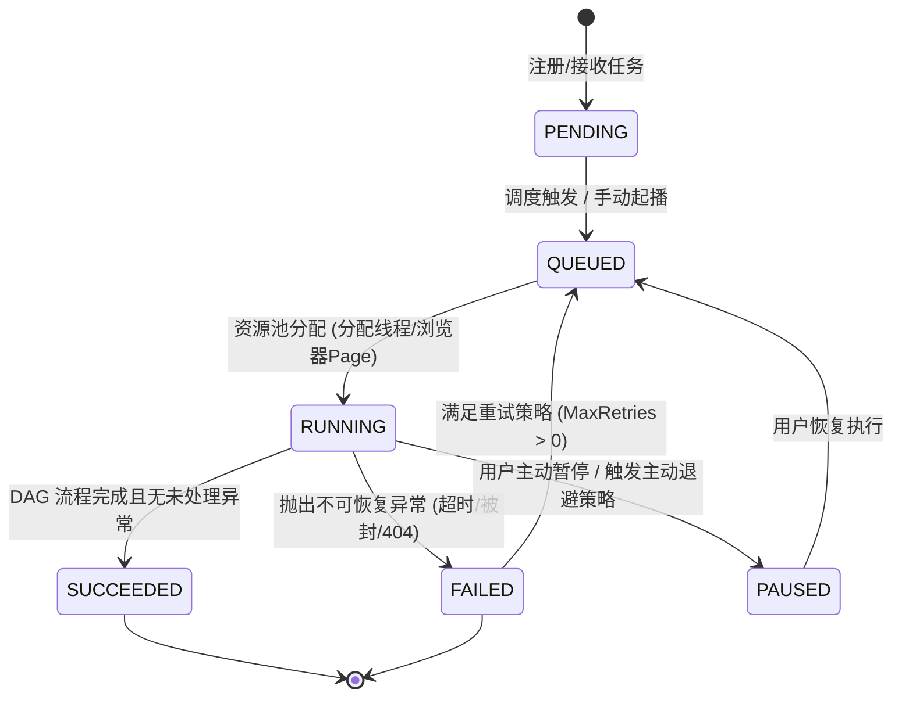

# 爬虫引擎微内核、任务状态机、并发管理与本地存储规范 (Engine Core Spec)

> **规范定位**：定义独立爬虫引擎的运行时微内核、任务生命周期状态机、无头浏览器池管理与本地嵌入式 SQLite 存储契约。

---

## 1. 架构模型与通信契约

### 1.1 进程与通信模型
1. **轻量异步微内核**：
   - 基于 Python 3.12+ `asyncio`、`FastAPI` 与 `Uvicorn` 构建；
   - 采用单一主事件循环协调 HTTP 服务、DAG 任务执行器与后台定时调度器。
2. **安全本地环回绑定 (Loopback Binding)**：
   - 默认且强制仅绑定本端安全环回地址：`127.0.0.1:18000`；
   - 严禁在未配置安全鉴权网关的情况下直接将服务暴露于公网 `0.0.0.0`。
3. **接口分层**：
   - `/api/v1/jobs/*`：本地采集任务增删改查与即时触发；
   - `/api/v1/flow/run`：即时无状态 FlowDSL 执行接口；
   - `/api/v1/extract`：单 URL / 单片段智能自愈提取接口；
   - `/internal/api/v1/executor/pipelines:execute`：标准化微服务管线执行接口；
   - `/health` / `/metrics`：健康检查与本地资源运行指标。

---

## 2. 任务生命周期与状态机 (Job Lifecycle & State Machine)

### 2.1 任务状态流转图

### 2.2 操作守卫与并发控制
1. **原子任务锁 (Job Execution Guard)**：
   - 同一 `job_id` 在同一时刻严禁并发多次执行；
   - 在任务进入 `RUNNING` 态前，必须通过本地内存锁或 SQLite 事务标记 `status = 'RUNNING'`，抢占失败者自动排队或忽略；
2. **超时熔断 (Execution Timeout Guard)**：
   - 单次流水线执行必须受制于最大超时时长 `timeout_seconds`（默认 120 秒）；
   - 超时后引擎必须主动调用 `asyncio.wait_for` 超时取消，并关闭当前关联的浏览器 Page，防止僵尸进程。

---

## 3. 浏览器池生命周期与资源防泄漏契约 (Browser Pool Lifecycle)

### 3.1 背景与风险
动态渲染（Playwright / Chromium）是极其消耗 CPU 与内存的重量级组件。
若无严格的池化管理与超时回收，长时间运行极易导致内存泄漏、孤儿 Chromium 进程打满服务器 CPU。

### 3.2 强制规则 (Rules)
| 规则 ID | 规范描述 | 默认参数 | 强制要求 |
|---|---|---|---|
| **RULE-POOL-01** | **最大并发页面数限幅 (Max Page Limit)** | `MAX_PAGES = 5` | 当活跃页面数达到阈值时，新任务必须通过信号量（`asyncio.Semaphore`）排队，严禁无限开 Tab。 |
| **RULE-POOL-02** | **空闲超时自动回收 (Idle Timeout Purge)** | `BROWSER_IDLE_TIMEOUT = 120s` | 当超过设定秒数无任何抓取任务时，引擎必须优雅关闭整个 Chromium 实例，释放数百兆显存与内存。 |
| **RULE-POOL-03** | **无头模式强制隔离 (Headless Isolation)** | `HEADLESS = True` | 生产与边缘常态化采集默认开启 Headless 模式；仅在开发者本地调试规则（`debug=true`）时才允许临时唤起带头窗口。 |
| **RULE-POOL-04** | **Page 上下文严格注销 (Strict Page Teardown)** | `try...finally` | 任何通过 `browser.new_page()` 分配的页面，无论任务成功、失败还是超时，必须在 `finally` 块中调用 `await page.close()`。 |

---

## 4. 本地嵌入式存储规范 (Embedded SQLite Schema)

### 4.1 数据库定位
- 默认采用单文件本地嵌入式数据库：`data/scraper_engine.db`；
- 开启 SQLite WAL 模式（`PRAGMA journal_mode=WAL;`）以支持高并发读与单写入隔离，杜绝 `database is locked` 异常。

### 4.2 核心数据表契约
1. **`local_spider_job`（任务元数据与声明式 Spec）**：
   - `job_id` (VARCHAR PK)：任务全局唯一标识；
   - `name` (VARCHAR)：任务易读名称；
   - `spec_json` (TEXT)：完整的声明式 FlowDSL / WebAppSpec 规则包；
   - `cron_expression` (VARCHAR)：Cron 调度表达式（为空表示仅手动单次执行）；
   - `status` (VARCHAR)：`ACTIVE` / `DISABLED` / `RUNNING`；
   - `updated_at` (DATETIME)。
2. **`local_spider_run`（运行历史与度量）**：
   - `run_id` (VARCHAR PK)；
   - `job_id` (VARCHAR FK)；
   - `start_time` / `end_time` (DATETIME)；
   - `records_count` (INTEGER)：本次抽取出的有效记录数；
   - `status` (VARCHAR)：`SUCCEEDED` / `FAILED`；
   - `error_message` (TEXT)。
3. **`local_raw_data`（采集产物暂存）**：
   - `id` (INTEGER PK AUTOINCREMENT)；
   - `job_id` (VARCHAR)；
   - `run_id` (VARCHAR)；
   - `data_hash` (VARCHAR)：内容去重指纹（SHA256(url + fields)）；
   - `payload_json` (TEXT)：提取出的标准 JSON 结构；
   - `created_at` (DATETIME)。

---

## 5. 验收准则与测试矩阵 (Test Matrix)

### 5.1 验收基准
1. **内存稳定性验收**：并发执行 50 次连续抓取任务后，系统总内存占用增量必须收敛在 50MB 以内，无孤儿 Python/Chromium 进程残留；
2. **调度自愈验收**：在设置 10 秒间隔定时任务后，调度器能够准确触发、抢占锁并更新 SQLite 状态；
3. **单例隔离验收**：多个独立任务之间变量上下文（`context.variables`）完全隔离，禁止跨任务状态污染。

### 5.2 关联自动化测试
- 任务与 API 测试：`pytest tests/test_job_service.py`、`pytest tests/test_api_endpoints.py`
- 浏览器池管理测试：`pytest tests/test_browser_pool.py`
- 安全隔离测试：`pytest tests/test_security.py`
